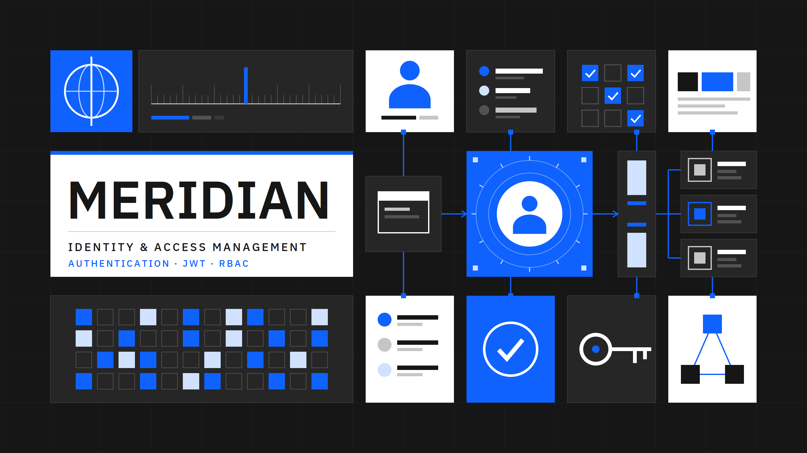
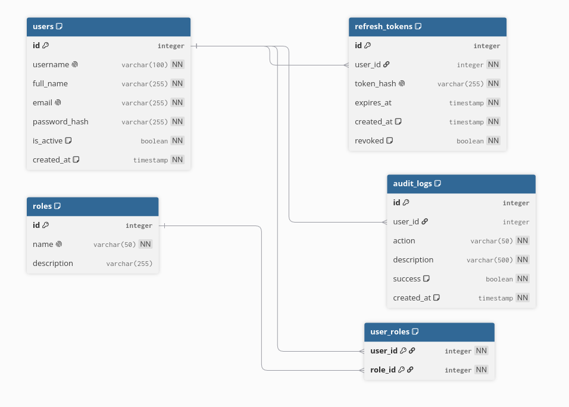

<div align="center">



# Meridian

[](https://www.python.org/)
[](https://fastapi.tiangolo.com/)
[](https://sqlmodel.tiangolo.com/)
[](https://www.postgresql.org/)
[](https://redis.io/)
[](https://docs.docker.com/compose/)
[](LICENSE)

</div>

Meridian is an authentication and user-management API built with FastAPI. It uses PostgreSQL for persistent data and Redis for caching.

<div align="center">



</div>

## Run with Docker Compose

You will need Docker and the Docker Compose plugin.

1. Clone the repository and enter the project directory:

   ```bash
   git clone https://github.com/Valentins-Jermakovs/Meridian.git
   cd Meridian
   ```

2. Create the environment file:

   ```bash
   cp .env.example .env
   ```

   Set private values for `POSTGRES_PASSWORD`, `JWT_SECRET_KEY`, and `PGADMIN_DEFAULT_PASSWORD`. Leave `REDIS_PASSWORD` empty; Redis is not configured with a password in the Compose file.

3. Create the external Docker network (skip this if it already exists):

   ```bash
   docker network create back_end
   ```

4. Build and start the services:

   ```bash
   docker compose up --build -d
   ```

The API documentation is available at [http://localhost:8000/docs](http://localhost:8000/docs). pgAdmin is available at [http://localhost:5050](http://localhost:5050), using the credentials in `.env`.

Stop the services with:

```bash
docker compose down
```
